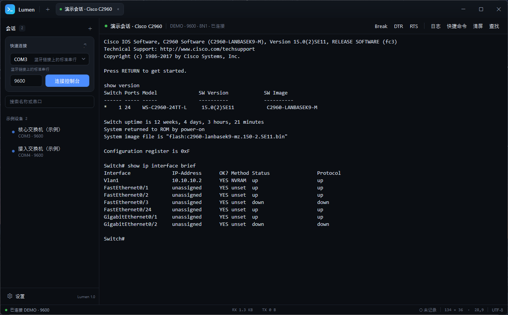

# Lumen Terminal 1.1.13

Lumen 是一个 Windows 串口终端，用于交换机、路由器、防火墙等网络设备的串口调试。界面基于 WPF，终端使用自绘控件，串口直接调用 Win32 API；不使用 WebView、Electron 或 Tauri。



## 功能

- 串口：COM 口枚举、波特率/数据位/校验/停止位/流控、DTR/RTS、Send Break。
- 终端：VT100/ANSI、10,000 行回滚、搜索、选区复制、GBK/UTF-8。
- 会话：会话分组、快速连接、手动重连、单实例。
- 运维：粘贴节流、危险命令确认、登录后自动分页、快捷命令。
- 日志：自动记录、可选时间戳、按会话命名、打开日志目录。
- 界面：深色主题、标签页、可调字号，支持 UI Automation 读取和选择终端文本。

## 厂商模板

内置 13 家厂商模板。新建或编辑会话时选择厂商，会带出默认波特率、编码、分页命令和快捷命令；连接后也可以根据设备 Banner 自动识别。

| 厂商 | 默认串口 | 自动关闭分页 | 编码 |
|---|---|---|---|
| Cisco IOS / IOS-XE | 9600 8N1 | `terminal length 0` | UTF-8 |
| 华为 VRP | 9600 8N1 | `screen-length 0 temporary` | GBK |
| H3C Comware | 9600 8N1 | `screen-length disable` | GBK |
| 中兴 ZXR10 | 9600 8N1 | `terminal length 0` | GBK |
| 锐捷 RGOS | 9600 8N1 | `terminal length 0` | GBK |
| 迈普 MyPower | 9600 8N1 | `terminal length 0` | GBK |
| TP-Link JetStream | 9600 8N1 | `terminal length 0` | GBK |
| Juniper Junos | 9600 8N1 | `set cli screen-length 0` | UTF-8 |
| Arista EOS | 9600 8N1 | `terminal length 0` | UTF-8 |
| Aruba / HPE | 9600 8N1 | `no page` | UTF-8 |
| Dell OS10 / OS9 | 9600 8N1 | `terminal length 0` | UTF-8 |
| Extreme EXOS | 9600 8N1 | `disable clipaging` | UTF-8 |
| MikroTik RouterOS | 115200 8N1 | 不发送 | UTF-8 |

分页命令和中文编码以设备手册和实际输出为准。国产设备出现中文乱码时，优先改用 GBK。

## 使用

1. 解压 `Lumen-1.1.13-win-x64.zip` 到可写目录，例如 `D:\Tools\Lumen`。
2. 运行 `Lumen.exe`。
3. 在左侧“快速连接”选择 COM 口和波特率，点击“连接控制台”。
4. 没有设备时，可以点“打开演示会话”查看界面。

首次启动的会话列表为空。程序目录会生成 `data` 和 `logs`（便携模式）；删除 `portable.flag` 后，配置会改用 `%APPDATA%\Lumen`。

## 快捷键

| 快捷键 | 功能 |
|---|---|
| `Ctrl+Shift+T` | 新建会话 |
| `Ctrl+Shift+W` | 关闭当前会话 |
| `Ctrl+Tab` / `Ctrl+Shift+Tab` | 切换标签 |
| `Ctrl+1` — `Ctrl+9` | 跳到指定标签 |
| `Ctrl+F` | 在当前会话中查找 |
| `Ctrl+Shift+A` | 全选屏幕内容 |
| `Ctrl+Shift+C` / `Ctrl+C` | 复制；无选区时发送 Ctrl+C |
| `Ctrl+V` / `Ctrl+Shift+V` | 粘贴 |
| `Ctrl++` / `Ctrl+-` / `Ctrl+0` | 放大 / 缩小 / 重置字号 |
| `Shift+PageUp` / `Shift+PageDown` | 翻看回滚缓冲 |
| `Shift+Home` / `Shift+End` | 跳到回滚顶部 / 底部 |
| `F11` | 最大化 / 还原 |
| `Ctrl+Break` | 发送串口 Break |

## 数据与日志

- 便携模式：`程序目录\data\sessions.json`、`settings.json`、`程序目录\logs\*.log`
- 非便携模式：`%APPDATA%\Lumen\`、`文档\Lumen Logs\`
- 可以在会话编辑器中单独指定日志目录。
- 日志为 UTF-8 纯文本，自动去除 ANSI 控制序列；可以选择每行加时间戳。
- 日志可能包含设备配置、SNMP community、接口地址等信息。请限制日志目录权限，分享前先脱敏。

## 当前范围

目前只做串口。以下功能不在 1.1 范围内：

- SSH / Telnet / SFTP、端口转发、跳板机
- XMODEM / YMODEM / ZMODEM 文件传输
- 自动重连、批量群发、分屏
- 浅色主题、脚本引擎、插件

## 构建

需要 .NET 10 SDK（Windows）：

```powershell
dotnet build .\src\Lumen\Lumen.csproj -c Debug
dotnet publish .\src\Lumen\Lumen.csproj -c Release -r win-x64 --self-contained true -o .\dist\Lumen
```

或者直接运行：

```powershell
.\build.ps1
```

测试：

```powershell
dotnet run --project tests/Lumen.Tests/Lumen.Tests.csproj -c Release
```

发布包是 self-contained 的 win-x64 目录，目标机器不需要安装 .NET。程序约 60 MB，主要体积来自 .NET 运行时。

## 目录结构

```text
src/Lumen/
  Controls/       终端控件、UI Automation、IME
  Terminal/       VT 解析、屏幕缓冲、编码、按键
  Serial/         Win32 串口、端口枚举、演示会话
  Services/       会话存储、日志、设置
  Views/          会话编辑器、设置、确认框
  Themes/         深色主题和控件样式
  MainWindow.*    主窗口
tests/Lumen.Tests/  自检
```

## 说明

- 串口层使用 `CreateFile` / `SetCommState` / `EscapeCommFunction`，不依赖 `System.IO.Ports`。
- 终端默认保留 10,000 行回滚，可在设置中调整。
- 关闭标签时会异步结束日志；退出程序时会等待日志写入完成。
- 当前版本没有做代码签名，企业分发前建议使用内部证书签名，避免 SmartScreen 提示。

## License

MIT，详见 [LICENSE](LICENSE)。

---

Lumen Terminal 1.1.13
